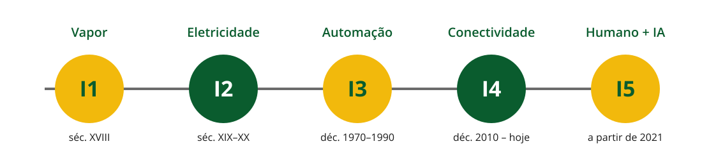
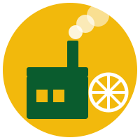
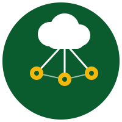
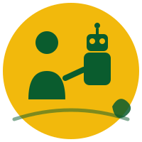

## Objetivos da aula

- Percorrer a linha do tempo das revoluções industriais, de **I1 a I5**
- Entender o que muda de uma revolução para a outra — e por que a 4ª é diferente
- Situar o técnico em Redes dentro dessa história
- Fechar com um gancho para os dias de hoje: a **uberização do trabalho**

::: {.notes}
Aula com forte conexão à área técnica do curso. O fechamento com
uberização é só um gancho — o conteúdo completo dela vem na Aula 07.
Bom momento para trazer exemplos concretos de redes industriais, IoT,
sensores.
:::

---

## O que é uma "revolução industrial"?

> Um salto tecnológico que muda **como se produz** — e, junto com isso, muda o trabalho, as cidades e a forma como a sociedade se organiza.

- Não é só "uma máquina nova" — é uma mudança que se espalha por toda a economia
- Cada revolução tem uma **tecnologia motriz**: vapor, eletricidade, eletrônica, rede, IA

## Linha do tempo: de I1 a I5

{fig-alt="Linha do tempo com cinco círculos numerados de I1 a I5, do vapor ao humano+IA" width="100%"}

::: {.callout-note}
**Pergunta rápida:** quantas revoluções industriais a maioria dos autores reconhece hoje?

::: {.fragment}
**Resposta:** quatro consolidadas (1ª a 4ª) — e uma 5ª em debate desde 2021, ainda sendo construída.
:::
:::

---

## I1 — A Revolução do Vapor {background-color="#fff8e1"}

::: columns
::: {.column width="35%"}
{fig-alt="Ícone de fábrica com chaminé e roda de engrenagem"}
:::
::: {.column width="65%"}
- **Século XVIII**, Inglaterra
- Máquina a vapor substitui a força humana e animal
- Tear mecânico, mineração, ferrovias
- Êxodo rural → nascem as cidades industriais
:::
:::

::: {.callout-note}
**Pergunta:** o que caracterizou a 1ª Revolução Industrial?

::: {.fragment}
**Resposta:** a mecanização da produção usando a força motriz do **vapor**, no lugar do trabalho manual e animal.
:::
:::

## I2 — A Revolução da Eletricidade {background-color="#fff8e1"}

::: columns
::: {.column width="35%"}
{fig-alt="Ícone de lâmpada acesa sobre uma linha de montagem"}
:::
::: {.column width="65%"}
- **Final do séc. XIX até início do séc. XX**
- Eletricidade e motor de combustão
- **Linha de montagem** e produção em massa (fordismo)
- Tarefas padronizadas e cronometradas (taylorismo)
:::
:::

::: {.callout-note}
**Pergunta:** qual inovação de gestão surge com a linha de montagem?

::: {.fragment}
**Resposta:** a **produção em série** — tarefas repetitivas, padronizadas e cronometradas, divididas entre vários operários.
:::
:::

## I3 — A Revolução da Automação {background-color="#fff8e1"}

::: columns
::: {.column width="35%"}
{fig-alt="Ícone de computador conectado a um braço robótico"}
:::
::: {.column width="65%"}
- **Décadas de 1970 a 1990**
- Eletrônica, computadores e controladores lógicos (CLPs)
- Robôs industriais entram na linha de produção
- A TI passa a fazer parte da fábrica
:::
:::

::: {.callout-note}
**Pergunta:** o que essa revolução tira das mãos do operário?

::: {.fragment}
**Resposta:** tarefas repetitivas e o controle de processo — passam a ser automatizadas por eletrônica e computadores.
:::
:::

## I4 — Indústria 4.0 {background-color="#fff8e1"}

::: columns
::: {.column width="35%"}
{fig-alt="Ícone de nuvem conectada a sensores em rede"}
:::
::: {.column width="65%"}
- **Da década de 2010 até hoje**
- Internet das Coisas (IoT), big data, inteligência artificial
- Sistemas ciberfísicos: máquinas, sensores e nuvem em **rede**
- Decisões automatizadas e em tempo real
:::
:::

::: {.callout-note}
**Pergunta:** a I3 já tinha computador na fábrica — o que a I4.0 tem de diferente?

::: {.fragment}
**Resposta:** a **conexão em rede** entre máquinas, sensores e sistemas — não é mais automação isolada, é um conjunto de dados trocados e decisões tomadas em tempo real.
:::
:::

## Onde entra o técnico em Redes? {background-color="#eaf5ec"}

::: {.incremental}
- Projetar e manter a **infraestrutura de rede** que conecta sensores, máquinas e sistemas
- Garantir **segurança** de redes industriais (um ataque pode parar uma fábrica inteira)
- Entender que essa rede **não é só técnica** — impacta empregos, rotinas e cidades inteiras
:::

## I5 — Indústria 5.0 {background-color="#fff8e1"}

::: columns
::: {.column width="35%"}
{fig-alt="Ícone de silhueta humana ao lado de um robô"}
:::
::: {.column width="65%"}
- Conceito lançado pela **Comissão Europeia em 2021**, ainda em construção
- Usa a mesma base tecnológica da 4.0 (IoT, IA, rede)
- Muda o **foco**: humano no centro, sustentabilidade, resiliência
- Colaboração humano-robô (*cobots*), não substituição pura
:::
:::

::: {.callout-note}
**Pergunta:** a Indústria 5.0 substitui a 4.0?

::: {.fragment}
**Resposta:** não. Ela usa a mesma tecnologia da 4.0, mas muda a prioridade: de "eficiência e lucro" para "pessoas, sustentabilidade e resiliência".
:::
:::

---

## As cinco revoluções, lado a lado

| | Período | Tecnologia motriz | Marca principal |
|---|---|---|---|
| **I1** | séc. XVIII | Vapor | Mecanização |
| **I2** | séc. XIX–XX | Eletricidade | Produção em massa |
| **I3** | 1970–1990 | Eletrônica | Automação |
| **I4** | 2010–hoje | Rede/IoT/IA | Conexão em tempo real |
| **I5** | a partir de 2021 | Rede/IoT/IA | Humano no centro |

---

## E depois da fábrica?

- Até aqui, toda revolução industrial mudou algo **dentro da fábrica**
- Mas a conectividade da I4.0 não ficou só lá dentro: saiu no bolso de todo mundo, no **smartphone**
- A mesma lógica de sensores + rede + dados em tempo real passou a organizar **trabalho fora da fábrica**

## O gancho: a uberização

{fig-alt="Ícone de smartphone com pino de localização conectado a um entregador" width="30%"}

> **A uberização é a transformação do trabalho em serviços sob demanda, mediados por aplicativos digitais.**

::: {.callout-note}
**Pergunta:** por que o nome vem de "Uber"?

::: {.fragment}
**Resposta:** a Uber foi pioneira nesse modelo de conectar oferta e demanda de serviço via aplicativo — o nome da empresa virou sinônimo do fenômeno mais amplo.
:::
:::

## Isso é conteúdo da Aula 07

::: {.incremental}
- Motorista, entregador, prestador de serviço avulso: cada um vira um "ponto de rede" conectado por um app
- A mesma infraestrutura (geolocalização, nuvem, algoritmos) que estudamos na I4.0 sustenta esse modelo
- Vantagens (flexibilidade) e problemas (precarização, ausência de vínculo) — vamos aprofundar isso **na Aula 07: Uberização e Plataformização**
:::

---

## Atividade da aula

:::: {.callout-lab}
**Em grupos (12 min):**

1. Escolham uma das cinco revoluções (I1 a I5)
2. Descrevam, com suas palavras, a tecnologia motriz e o que ela mudou no trabalho
3. Conectem com o presente: algo da uberização (app, entrega, corrida) usa ideias dessa revolução? Qual?
::::

## Síntese da aula

- Cinco revoluções, cinco tecnologias motrizes: vapor, eletricidade, eletrônica, rede/IoT, e agora humano+IA
- A Indústria 4.0 se diferencia por conectar máquinas, sensores e sistemas em **rede**, em tempo real
- A Indústria 5.0 não troca a tecnologia da 4.0 — troca o foco, colocando o humano no centro
- Essa mesma conectividade, fora da fábrica, deu origem à **uberização** — tema da próxima aula

## Próxima aula

**Tecnologia, educação e qualificação humana** — como essas mudanças afetam a forma como aprendemos e nos formamos

---

## Referências

- GIDDENS, Anthony; SUTTON, Philip W. *Sociologia*. 6. ed. Porto Alegre: Penso, 2012.
